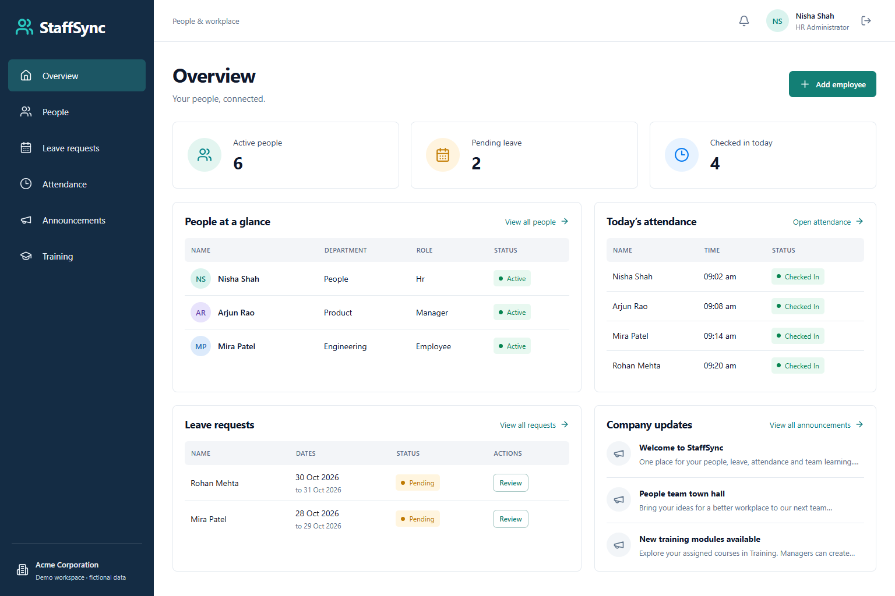

# StaffSync

An HR management app built with MongoDB, Express, React and Node.js. HR staff manage employee records, managers review team requests, and employees track their leave and attendance.



## Features

- Sign-in and registration with role-based access
- Employee profiles, departments and manager assignments
- Leave requests, approvals and notifications
- Daily attendance check-in/out and CSV exports
- Company announcements and training assignments
- Searchable employee directory and mobile layouts

## Run locally

Requires Node.js 24 and npm.

```sh
npm ci
npm run demo
```

Open [localhost:5173](http://localhost:5173). The demo starts a local MongoDB server and loads sample accounts. On the first run, it downloads MongoDB (about 600 MB on Windows). Data is saved in `.data/mongo` between runs.

| Role | Email |
| --- | --- |
| HR | hr@example.test |
| Manager | manager@example.test |
| Employee | employee@example.test |

Password for all sample accounts: `StaffSyncDemo2026!`

## Use your own database

Copy `.env.example` to `.env`. Set `MONGODB_URI`, a random `JWT_SECRET` of at least 32 characters, and the bootstrap email and password. The bootstrap password must be 12–128 characters.

```sh
npm ci
npm run build
npm run bootstrap
npm start
```

Remove the bootstrap credentials from `.env` after creating the HR account. Open [localhost:4000](http://localhost:4000).

For development, run `npm run dev` for the API and `npm run client` in another terminal for the frontend. Vite forwards `/api` requests to port 4000.

## Tests

```sh
npm test
npm run build
```

Backend tests use a separate MongoDB database. MongoDB is downloaded on the first test run; set `STAFFSYNC_TEST_CACHE` to use an existing binary cache.

## Project files

| Folder | Contents |
| --- | --- |
| `client/` | React pages and components |
| `server/` | Express API, Mongoose models and tests |
| `scripts/` | Local demo launcher and sample data |
| `docs/` | Project report, screenshots and architecture |

[Project report](docs/StaffSync-Project-Report.pdf) · [Architecture](docs/architecture.md) · [Screenshots](docs/screenshots)

## Limitations

API lists have fixed record limits. Profile updates across collections and leave-overlap checks need stronger concurrency handling. Password recovery, organization invitations and audit logging are planned improvements.
