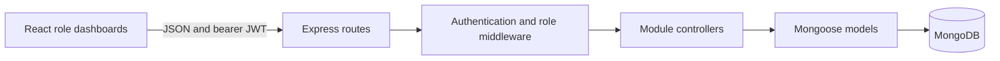
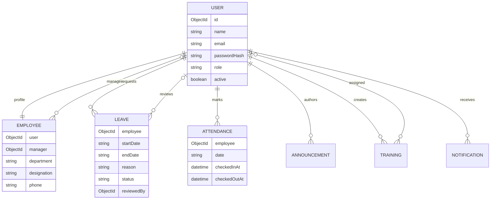

# StaffSync architecture

## Technical architecture and MVC

The React client calls the Express REST API using JSON and a bearer JWT. Routes select controllers; middleware authenticates the user and enforces roles; controllers validate input and apply team scoping; Mongoose models persist records in MongoDB. The normal server validates configuration and connects the configured database. The demo launcher starts an official MongoDB process with a persistent WiredTiger data directory and serves the same client/API together on localhost:5173.

## ER diagram

## Roles and responsibilities

| Role | Responsibilities | Boundaries |
|---|---|---|
| HR | Employee creation and profile administration; manager assignment; leave review; attendance oversight; announcements and training | Cannot review own leave or deactivate own account |
| Manager | Direct-team records and attendance; team leave review; training assignment; announcements | Cannot review other teams, change roles, or modify another manager's announcement |
| Employee | Own profile, leave requests, attendance; company announcements and assigned training | Cannot select another identity when marking attendance or grant privileged roles |

Passwords use salted scrypt. JWTs have a fixed algorithm, issuer, audience, and expiry; active status and current role are reloaded on each request. Unique indexes protect email, employee profile ownership, and one attendance record per employee/day.

## User flows

1. HR bootstrap -> employee registers or is created by HR -> HR assigns department, designation, role and manager.
2. Login -> receive JWT -> fetch current user and scoped data -> render the role dashboard.
3. Employee applies for leave -> pending -> direct manager or HR reviews -> approved/rejected; a second decision returns a conflict.
4. Employee checks in -> unique daily attendance -> checks out -> HR/direct manager reads records.
5. HR/manager publishes announcement -> signed-in employees read it.
6. Manager creates training for direct reports -> assigned employees see it and receive private notifications.
7. Employees read review/assignment notifications -> mark individually or all as read.

## Implementation decisions and remaining limits

Dates use ISO `YYYY-MM-DD`; attendance boundaries use Asia/Kolkata's UTC+05:30 offset. Timestamps remain UTC. Employee removal is deactivation to retain attendance and leave history. The interface paginates returned tables in groups of ten and exports CSV records; server-side lists are bounded. Password reset, invitations, audit logs, server-side pagination and cloud hosting remain future improvements. Profile updates spanning User and Employee documents are not transactional. Managers are User roles, avoiding duplicated identities. Notification delivery is best-effort after the primary save.
